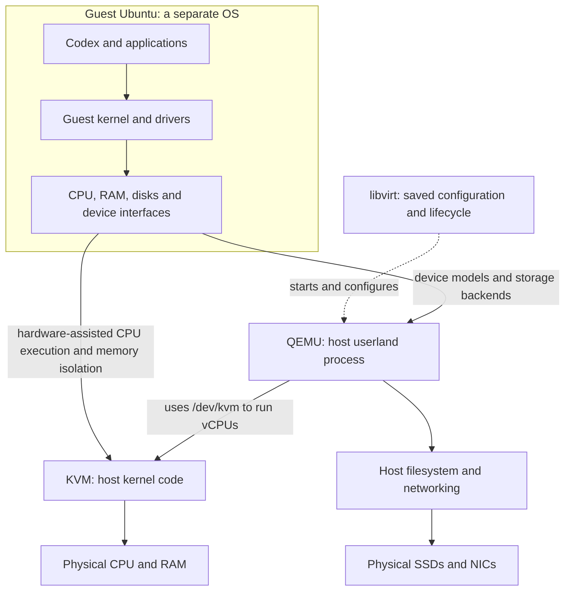
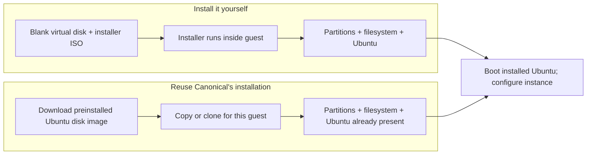
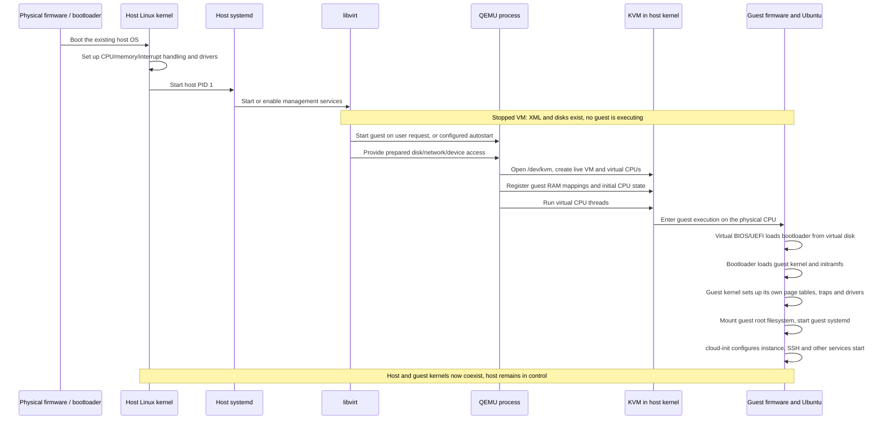
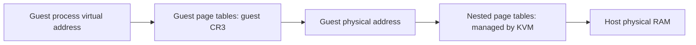
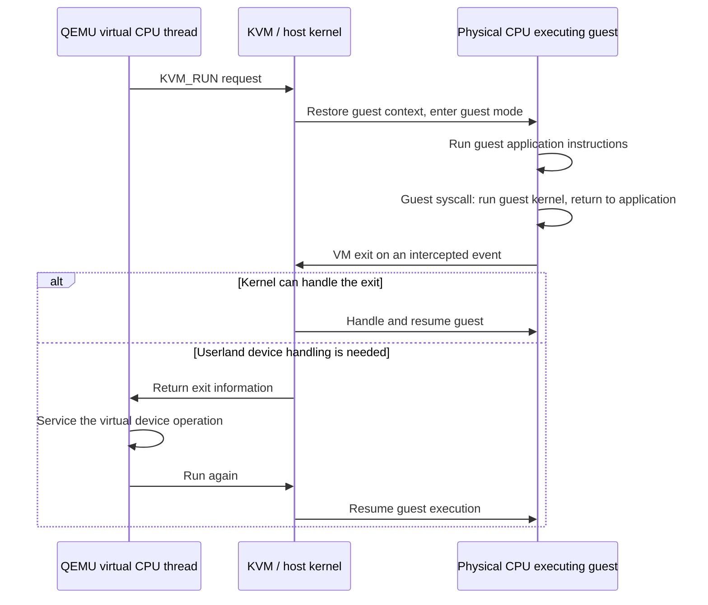
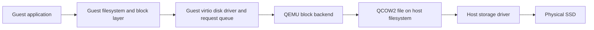
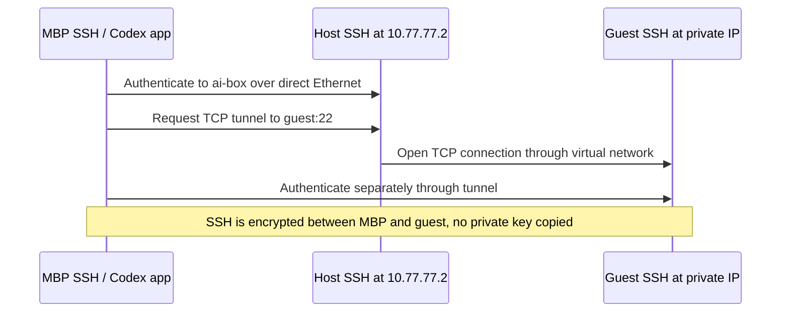

# How the disposable GPU workstation works

A **virtual machine (VM)** is a machine interface on which an operating system
can boot: CPUs, memory, firmware, disks and devices. Its resources are backed by
real hardware, but the guest OS gets a controlled view of them rather than
control of the whole physical PC.

Your existing Ubuntu is the **host**: its kernel owns the physical machine and
runs the virtualization software. The Ubuntu booted inside the VM is the
**guest**: it has its own kernel, users, services and files. Guest root can
administer that machine without acquiring host root privileges.

Three components divide the work: **QEMU provides virtual hardware; KVM runs
the guest's CPU instructions with hardware-enforced isolation; libvirt
configures and manages the machine.** The guest is ordinary Ubuntu with its
own kernel. In this setup, most instructions execute directly rather than
being interpreted by software.

For this project, the goal is a disposable workstation where Codex can install
software and use the RTX 5090. The host keeps control of lifecycle and protection;
the original model library stays outside the guest's writable storage.

**Implementation status:** the current scripts provision one ordinary VM.
GPU passthrough, model sharing and disposable clones remain planned. No host
provisioning has been run for this work. The architectural explanations below
are not a claim that these planned features already work on this machine.

## 1. Start with the machine the guest sees

“Virtual” describes the interface and ownership, not whether real computation or
storage happens. Some resources are multiplexed; others are assigned exclusively.

| Guest resource | What backs it on the host | What this means here |
| --- | --- | --- |
| Virtual CPU (vCPU) | A host thread scheduled onto a physical CPU, using KVM | Eight vCPUs do not automatically reserve eight cores |
| Guest RAM | Host RAM mapped into the VM | Guest addresses are restricted to its assigned memory |
| Virtual disk | A disk image file on a host filesystem | Guest formatting changes that file's contents, not the physical SSD's partition table |
| Virtual NIC | A software device connected to host networking | It has its own MAC/IP without owning a physical NIC |
| Assigned GPU | The physical 5090, connected through PCI passthrough | One guest owns the GPU; the host cannot use it simultaneously |
| Shared model directory | Selected host files exposed through a file-sharing device | Host-enforced read-only access preserves the original models |

Arrows show responsibilities and dependencies, not a process tree or the path of
every instruction. The guest ultimately executes on the physical CPU; the next
sections explain who constructs its environment and what gets saved.

## 2. Who builds, runs and manages that machine?

There are two different jobs: **running** a machine and **managing** it. QEMU
and KVM provide execution; libvirt removes the need to assemble QEMU command
lines, permissions, disks and networking by hand for each start.

| Component | What it is | When it exists/runs |
| --- | --- | --- |
| Host Linux | Kernel controlling the physical CPU, RAM and devices | Throughout the host's uptime |
| KVM (`kvm`, `kvm_amd`) | Host kernel code exposing hardware virtualization through `/dev/kvm`; not a daemon | Available while modules are loaded; live VM state exists while a VM runs |
| QEMU | Host userland program implementing a virtual machine's devices and coordinating execution through KVM | Normally one process per running VM, with multiple threads; absent for stopped guests |
| libvirt | Management library/API plus host daemons; starts QEMU, prepares access to devices and saves configuration | Host services, independent of whether guests are running |
| `virsh` / `virt-install` | Short-lived clients that ask libvirt to manage or create a guest | When you invoke a management command |

Ubuntu's systemd (host PID 1) manages libvirt and the firewall service. Depending
on packaging, libvirt uses one daemon (`libvirtd`) or several (`virtqemud`, etc.),
and sockets can start daemons on demand. Our current scripts use `libvirtd`.
QEMU need not be a separate always-on service: libvirt launches it when asked to
start a guest. Libvirt does not execute the guest's instructions, and restarting
its management daemon normally does not require shutting down running QEMU VMs.
See [libvirt daemons](https://libvirt.org/daemons.html).

From the host's `ps`, you see QEMU and its threads, including virtual CPU
threads, plus supporting helpers. The guest's applications are not separate
ordinary host processes: the guest kernel schedules them onto its vCPUs.

**Is QEMU the hypervisor?** People call the combination **QEMU/KVM** the
hypervisor. KVM handles protected CPU execution in the kernel; QEMU supplies
userland machine/device support; libvirt manages them. It is not all implemented
inside one userland process. See [QEMU's overview](https://www.qemu.org/docs/master/system/introduction.html).

## 3. A stopped VM is configuration and stored data

A VM needs to survive shutdown without keeping its execution machinery alive.
It therefore separates the **recipe for a machine**, its **disk contents**, and
its temporary **running state**.

A **libvirt definition** is a machine description in XML: name/UUID, CPU and RAM
settings, disk file paths, virtual NIC/MAC, boot firmware and assigned PCI devices.
It is configuration, not running hardware and not the guest OS itself.

`virsh define machine.xml` imports a persistent definition into libvirt. With
Ubuntu's system libvirt, persistent QEMU definitions are normally stored under
`/etc/libvirt/qemu/`. Use `virsh dumpxml NAME` to inspect them and libvirt tools to
edit them; do not edit daemon-owned files behind its back. A different libvirt
network XML describes the bridge, subnet and DHCP configuration. See
[domain XML](https://libvirt.org/formatdomain.html) and
[network XML](https://libvirt.org/formatnetwork.html).

| State | Where it lives | Survives ordinary guest shutdown? |
| --- | --- | --- |
| Machine definition | libvirt's persistent host configuration | Yes |
| Guest partitions, filesystem, OS and files | VM disk image file(s) | Yes |
| Virtual UEFI variables, if UEFI is selected | A separate host NVRAM file | Yes |
| Guest RAM and device state | Host RAM, QEMU and kernel objects | No, unless explicitly saved |
| Virtual CPU registers and virtualization controls | Kernel-managed memory and physical CPU state while executing | No; reconstructed on the next cold start |
| Host models | Original files on `/mnt/data` | Yes; guest reset does not delete them |

Loading KVM enables the host's ability to run VMs. The host kernel does not read
all saved XML files on boot and register permanent “hardware VMs.” Libvirt reads
those definitions; live kernel VM objects are created when QEMU starts a VM.
Guest autostart is an optional libvirt policy; our current guest does not autostart.

### Put an operating system on the virtual disk

Defining hardware does not install software. QEMU can present a disk, CPU and
NIC with no operating system installed, just as a physical PC can have an empty
SSD. Something must put partitions, a filesystem and an OS onto that disk.

There are two ordinary ways to put Ubuntu on that virtual machine:

| Installation route | What happens |
| --- | --- |
| Empty disk + Ubuntu installer ISO | Boot the installer in the guest; it partitions/formats the **virtual** disk and installs Ubuntu. Then boot the installed disk. |
| Ubuntu cloud disk image | Start from a disk that Canonical already partitioned, formatted and installed Ubuntu onto; boot that installed OS directly. |

Both run on the same virtual hardware. An ISO is normally installation media;
a cloud disk image is a preinstalled machine disk, often packaged as QCOW2.
QCOW2 describes how virtual disk blocks are stored in a host file. The guest
filesystem, such as ext4, is **inside** those blocks.

### Configure an instance without installing Ubuntu again

The preinstalled image is deliberately generic: it cannot already know your
hostname, SSH key or required packages. **Cloud-init** is guest software that
solves this last step by reading instance configuration during boot.

“Cloud” describes the original use case: providers need to start many machines
from one generic image and configure each without clicking through an installer.
It does **not** mean the VM runs remotely, needs an AWS account, or sends its disk
to a cloud service. Cloud-init also supports the **NoCloud** data source: local
files on a small virtual seed disk/CD-ROM containing hostname, public SSH keys
and setup instructions. The current scripts generate that seed ISO and attach
it alongside the Ubuntu disk. See
[Ubuntu's local cloud-init example](https://ubuntu.com/docs/public-images/public-images-how-to/use-local-cloud-init-ds/)
and [NoCloud](https://docs.cloud-init.io/en/latest/reference/datasources/nocloud.html).

We enlarge the virtual disk's capacity; the guest can then expand its existing
partition/filesystem into that space. No physical SSD is reformatted. On first
boot cloud-init creates/configures the guest user and installs the requested
tools. Subsequent boots normally keep those installed files; many first-boot
steps do not repeat. See [cloud-init](https://docs.cloud-init.io/en/latest/explanation/introduction.html).

## 4. Starting a VM turns that recipe into a running machine

There are two boots, with different owners. The host boots the physical PC;
later, QEMU/KVM provide a machine on which the guest performs its own boot.
Starting a VM does not reboot the host or replace its kernel.

A simplified host boot is firmware → bootloader → host kernel/initramfs → host
root filesystem → systemd/services. The host kernel establishes memory
protection, page tables, exception/interrupt handling and device drivers before
ordinary userland uses them. KVM modules may load during boot or later on demand.

Virtual firmware is code executed by the guest's virtual CPUs; it is not a
second physical motherboard firmware boot. BIOS versus UEFI depends on the VM
configuration. A cloud image skips OS installation, not this guest boot sequence.

**Where privileges enter:** host administration installs services, creates the
bridge/firewall and grants QEMU access to KVM, disks and assigned devices.
Libvirt's privileged service prepares that access, while QEMU normally runs
under the restricted host account `libvirt-qemu`. `/dev/kvm` is a permissioned
kernel interface, not unrestricted access to kernel memory. This setup uses
host `sudo` for management; guest `codex` sudo grants privileges in the guest.

## 5. How the guest executes directly without controlling the host

A virtual CPU is represented by a QEMU host thread plus kernel-maintained state.
QEMU asks KVM to run it; that thread enters the host kernel and then guest CPU
execution. The host scheduler still decides when that thread gets physical CPU
time. Eight vCPUs does not automatically reserve eight physical cores.

Most guest instructions run directly on the physical CPU. Hardware virtualization
adds a distinction between **host execution** and **guest execution**, separate
from ordinary user/kernel privilege levels. The guest can run its own ring-0
kernel without becoming the host's ring-0 kernel.

### Mapping guest memory onto host memory

The guest needs addresses it can manage independently; the host needs to prevent
those addresses from referring to other host processes or the host kernel.

The guest translates a process virtual address into a guest physical address
using its own page tables, selected by its `CR3` register. Hardware nested page
tables translate that into host physical RAM. Translation lookaside buffer
(TLB) caching accelerates this; QEMU does not look up every load/store. A guest mapping
cannot simply name arbitrary host RAM. Ordinary KVM does not hide guest memory
from the host administrator.

The RAM is backed by mappings in QEMU's host address space; KVM manages the
hardware translation to the underlying host pages. See
[KVM memory translation](https://docs.kernel.org/virt/kvm/x86/mmu.html).

### Switching between guest execution and host handling

The problem is not only running instructions quickly: a guest kernel expects
to control privileged CPU state. Hardware virtualization gives it its own
execution context and lets KVM decide which events require host intervention.

The host already has its own interrupt descriptor table (IDT), trap handlers
and syscall entry setup. The guest kernel creates its own equivalents and sets
its guest `IDTR` (the register locating the IDT), page-table root (`CR3`), and
other privileged state.
Virtualization keeps these contexts separate. A normal guest syscall or guest
page fault can be handled by the guest kernel; it need not bounce through QEMU.
An intercepted operation causes a **VM exit**, a hardware transition to KVM's
host handling, rather than adding a new host IDT entry for every VM. Some exits
are handled entirely in KVM; others return to QEMU for device handling.

KVM's API represents VMs/vCPUs as file descriptors and exposes requests such as
`KVM_CREATE_VM`, memory registration and `KVM_RUN`. A saved XML definition is
not one of these runtime kernel objects. See [the KVM API](https://docs.kernel.org/virt/kvm/api.html).

### Where the CPU keeps this privileged state

Your Ryzen uses AMD SVM. In simplified terms, KVM manages:

| Mechanism | Purpose |
| --- | --- |
| `EFER.SVME` | Privileged CPU control enabling SVM execution |
| VMCB (Virtual Machine Control Block) | Kernel-managed memory describing guest CPU state, interception rules, interrupt controls and nested paging settings |
| `VM_HSAVE_PA` | Privileged register pointing to host state-save memory used for SVM transitions |
| `VMRUN` / VM exit | Enter guest execution; return to host handling on configured events |

These are managed per execution context/physical CPU as needed, not written
into a magic permanent CPU slot for each saved VM. Some state is held in CPU
registers while running, some in memory; hardware and KVM cooperate to save and
restore it. Intel provides analogous facilities with different names. See
[AMD's architecture manual, SVM chapter](https://docs.amd.com/api/khub/documents/sD1_QL~h4Afq2_tvzxqqSQ/content).

Direct instruction execution and hardware memory translation explain why CPU
work can be close to native. VM exits, scheduling and device I/O still have
costs; CPU-heavy, disk-heavy and network-heavy workloads need not have the same
overhead. The next section follows what happens when the guest requests I/O.

## 6. Devices turn guest requests into real I/O

Executing CPU instructions is only part of a computer. An OS also expects
registers, request queues and interrupts through which it can drive devices.
Virtualization must provide that contract and deliver the requested I/O.

| Approach | Problem it solves | How the guest reaches real hardware |
| --- | --- | --- |
| Emulated device | Run an existing driver expecting a conventional hardware model | QEMU implements that device's behavior in software |
| **Virtio** device | Avoid reproducing a complicated physical device when the guest supports a VM-specific driver | Guest and backend exchange requests through shared-memory queues and notifications |
| PCI passthrough | Give the guest direct control of a particular physical device | Assign the device through VFIO/IOMMU instead of emulating its main operations |

The guest discovers devices on its virtual PCI bus and loads the appropriate
drivers. With virtio, Linux knows the device is virtual; applications still get
normal disk and network interfaces. The backend is the host-side code servicing
those requests: QEMU for the disk path below, or potentially kernel code for
networking. Shared queues reduce handoffs; they do not make host work disappear.

### Storage: two filesystems with different owners

For a typical disk write:

The guest may format that disk without formatting the host SSD: it writes
filesystem structures into its virtual blocks, which become data inside the
image file. Reads/writes can be cached, batched or serviced asynchronously;
the diagram shows ownership, not every syscall. See
[QEMU's block formats](https://www.qemu.org/docs/master/system/qemu-block-drivers.html).

### Disposable storage without reinstalling everything

Recreating a fully provisioned disk each time would be slow and duplicate data.
A copy-on-write clone avoids that: the prepared base image stays unchanged.
Reads use the clone's changed blocks when present, otherwise the base; writes
go to the clone.
Deleting the clone loses its OS changes and downloads but leaves the base.
Do not remove a base still referenced by clones or modify an image in use.

### Networking: a NIC interface backed by software

The networking problem has two parts: give the guest a NIC it can drive, then
connect that NIC to other machines under host-controlled routing and policy.
The guest sees a **virtio NIC**, with its own MAC, IP and Linux interface. On
the host, a **TAP interface** carries Ethernet frames for that guest, and a
**software bridge** connects it to the host's virtual network. A bridge is a
software Ethernet switch; routing/NAT is a separate function. See
[Linux TAP](https://docs.kernel.org/networking/tuntap.html) and
[QEMU networking](https://www.qemu.org/docs/master/system/devices/net.html).

For guest internet traffic in the intended NAT setup:

```mermaid
flowchart LR
    subgraph guest["Guest OS"]
        socket["Application socket"] --> stack["Guest TCP/IP stack"]
        stack --> frontend["virtio-net driver / shared queues"]
    end
    subgraph host["Host OS"]
        backend["vhost-net kernel backend, or QEMU backend"] --> tap["Guest TAP interface"]
        tap --> bridge["virbr-codex software bridge"]
        bridge --> routing["Host routing, firewall and NAT"]
        routing --> nic["Host NIC driver"]
    end
    frontend --> backend
    nic --> physical["Physical Wi-Fi or Ethernet NIC"]
    physical --> internet["Router / internet"]
```

Receive traffic follows the reverse logical path. Host routing selects the
actual internet connection; your direct MBP Ethernet cable need not carry
internet traffic. NAT rewrites guest source addresses to the host's outward
address and tracks the return traffic; the guest still keeps its private IP.

**Does this bypass QEMU or the CPU?** With `vhost-net`, much of the virtio network
data handling happens in the host kernel instead of QEMU userland. Shared
queues, batching and offloads reduce overhead. QEMU still configures the virtual
device, and host CPU/network-stack work remains. This is not a direct physical
NIC-to-guest connection. Copies and notifications depend on the implementation;
“virtio” does not mean guaranteed zero-copy. See
[vhost-net](https://docs.redhat.com/en/documentation/red_hat_enterprise_linux/7/html/virtualization_deployment_and_administration_guide/sect-network_configuration-disabling_vhost_net).

Passing through a whole physical NIC, or an SR-IOV virtual function on suitable
hardware, is a different arrangement that can bypass much of the host network
path. It is not the proposed setup: we want the host to retain its NIC and
control guest routing/firewall rules. Direct GPU assignment does not require
direct NIC assignment.

### Your MBP reaches the guest through the host

A private guest address does not need to be directly routed onto your Ethernet
link. The host keeps its existing `10.77.77.2` address. SSH `ProxyJump` first
connects to the host's SSH server, which opens a connection to the guest's
private IP. A second, end-to-end SSH session authenticates to the guest; the
client private key stays on the MBP. This path does not need guest internet NAT.

Distinct simultaneous guests need distinct IP/MAC identities; replacements can
reuse a reserved identity after the old guest is removed. The current script
uses one fixed identity, `codex-vm` at `192.168.250.2`. A future clone command must
manage identities deliberately, not copy an active VM's identity blindly.

## 7. Choose ownership boundaries for the GPU and models

CPU, disk and network virtualization can share host resources. For the GPU,
our chosen tradeoff is different: dedicate the 5090 to the guest so it can use
its own NVIDIA driver and software stack.

**VFIO** is the host kernel framework used to assign the physical GPU to the
VM; the guest NVIDIA driver uses that GPU's interfaces. The host NVIDIA driver
cannot use it while assigned. The I/O memory management unit (IOMMU) maps the
device's memory accesses (DMA) to permitted host RAM; interrupt routing connects
device events to guest execution.
Much of the workload avoids emulating GPU operations, although setup, interrupt
handling and virtualization overhead remain. See
[VFIO](https://docs.kernel.org/driver-api/vfio.html).

Before implementing it, check IOMMU groups, host display dependencies and GPU
reset behavior. Boot configuration may reserve the GPU for VFIO; whether it
returns to host use after guest shutdown depends on the chosen binding policy.
One passed-through GPU has one owning guest at a time.

Models have the opposite requirement: reuse existing data without giving the
guest ownership of the originals. A separate host-enforced file share exposes
selected directories on `/mnt/data` read-only in the guest. This does not expose the
whole physical data SSD, and it must not merely be a guest-controlled read-only
mount. New downloads, packages and experiments go on the writable guest disk.
Export selected results before discard. A persistent disk that guest root can
write is persistent, but not protected from deletion by Codex.

## 8. Apply this model to dotfiles and everyday development

Dotfiles records how to prepare the host and build a guest. Those are separate
operations from starting an existing instance or discarding one. The intended
workflow is:

| Stage | Host effect | Developer experience |
| --- | --- | --- |
| Host preparation | Install QEMU/libvirt/tools; configure services, network/firewall and eventually VFIO | Approve host administration once; reboot if required |
| Base preparation | Download Ubuntu, boot/configure a guest, then shut down and retain a clean image | Wait for tools/drivers to install and verify GPU/isolation |
| Create an instance | Create a writable clone, define its identity/devices and start QEMU | Get a named SSH target and workspace |
| Work | Guest runs its own kernel, Codex and GPU tasks | Select guest in desktop app; authenticate Codex; allow full access inside it |
| Stop | Guest shuts down and QEMU exits; disks/definition remain | Resume later with its files intact |
| Discard/recreate | Remove the selected guest's definition and writable storage, then clone again | Start clean; original models and base survive |

Preparing the reusable base must clear instance-specific state so clones get
fresh machine IDs, SSH host keys and cloud-init instance state. Personal Codex
credentials should not be baked into that shared base. This keeps a reusable
installation separate from an individual machine's identity.

**Implemented today:** `setup_codex_vm.sh` is opt-in. It installs host packages,
configures services/network/firewall, downloads Ubuntu, defines and starts one
VM, then lets cloud-init provision it. Defaults: 8 vCPUs, 16 GiB RAM, 100 GiB disk.
Reruns preserve its existing disk; they do not implement disposable clones.
See [the current implementation guide](codex-vm.md).

**Still to implement:** GPU/VFIO configuration, guest NVIDIA driver setup,
verified read-only model access, prepared base images and explicit clone/reset
lifecycle commands. No new lifecycle command names are promised here yet.
Dotfiles should retain the configuration and provisioning recipe, while runtime
disks, models, outputs and credentials stay outside Git.

The intended normal operation is to work **inside the guest**, not grant Codex
host administration each time. Host-side controls start, stop and reset it.
New guests need authentication; only explicitly retained data survives discard.
